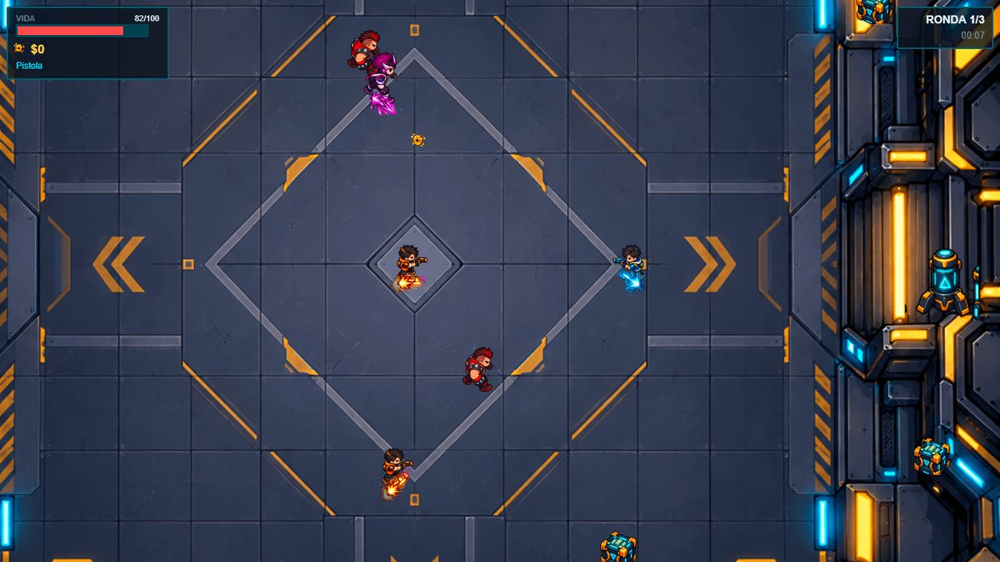

# Capital Rush

**Prototipo de videojuego educativo de acción y supervivencia con decisiones financieras.** Construido por Jhosep Vargas con Phaser 3, TypeScript y Vite para navegadores de escritorio y móviles.

En una arena de ciencia ficción, sobrevive, recoge créditos y decide qué hacer con tu capital entre rondas: comprar mejoras, invertir o mantener una reserva. Cada decisión cambia los recursos con los que afrontarás el siguiente combate. Los conceptos financieros se exploran jugando, mediante consecuencias visibles.

## Demo jugable

**[Jugar Capital Rush en el navegador](https://shiny-dust-0d10.jhosepvargas20021.workers.dev/)**

Puedes probar el juego directamente, sin instalar dependencias ni descargar el proyecto.



## Mecánicas y características

- Combate con vista cenital, movimiento libre, apuntado y disparo automáticos.
- Tres rondas: oleadas de enemigos y una batalla final contra **The Collector**, con dos fases y refuerzos.
- Tres tipos de enemigos: **Bruiser**, **Shooter** y **Lancer**, con comportamientos de combate diferentes.
- Adaptación de enemigos al movimiento del jugador, incluyendo distancia, permanencia en los bordes y patrones de desplazamiento.
- Cajas destructibles, créditos, curación y mejoras temporales.
- Decisiones entre rondas: equipo, inversión con ganancias o pérdidas, y reserva con rendimiento simulado.
- Mejoras de daño, cadencia de disparo, armadura y seguro de emergencia.
- Pantalla de resultados con puntuación, rango y análisis del reparto del capital entre equipo, inversión y reserva.
- Logros y mejor puntuación guardados en `localStorage`.
- Joystick táctil y paneles que adaptan su disposición a pantallas pequeñas. La interfaz del juego está en español.

## Conceptos educativos

| Concepto | Cómo aparece en el juego |
| --- | --- |
| Riesgo y rendimiento | Invertir puede aumentar o reducir el capital disponible. |
| Ahorro y reserva | Conservar créditos permite afrontar decisiones posteriores. |
| Liquidez | El dinero disponible determina qué mejoras puedes comprar. |
| Costo de oportunidad | Comprar potencia de combate reduce el capital que puedes invertir o reservar. |
| Gestión de recursos | La supervivencia exige equilibrar salud, equipo y dinero. |
| Protección ante imprevistos | El seguro de emergencia ofrece una curación automática bajo un umbral de salud. |

La economía utiliza reglas simplificadas y valores ficticios; los resultados financieros son parte de la simulación del juego.

## Controles

| Acción | Escritorio | Móvil |
| --- | --- | --- |
| Moverse | `W`, `A`, `S`, `D` o flechas | Joystick táctil en la zona inferior izquierda |
| Apuntar y disparar | Automático | Automático |
| Menús y decisiones financieras | Clic en los botones | Toque en los botones |

## Stack

- **Phaser 3:** escenas, renderizado y físicas Arcade.
- **TypeScript:** entidades, reglas de combate, economía y estado del juego.
- **Vite:** servidor de desarrollo y compilación de producción.
- **HTML y CSS:** página contenedora y estilos.
- **Sharp y Node.js:** procesamiento de sprites y assets.
- **localStorage:** persistencia local de logros y récord. El proyecto no requiere un backend ni claves de API.

## Ejecutar en local

Necesitas Node.js 22 LTS y npm.

```bash
npm ci
npm run dev
```

Abre la dirección que muestre Vite. Para crear y revisar la versión de producción:

```bash
npm run build
npm run preview
```

La compilación comprueba TypeScript y genera `dist/`. Esa carpeta y `node_modules/` están excluidas de Git.

## Estructura del proyecto

```text
src/
  data/           Estado y parámetros de balance
  entities/       Jugador, enemigos, proyectiles y objetos
  game/           Configuración de Phaser
  scenes/         Menú, combate, economía y resultados
  systems/        Combate, economía, puntuación, logros y efectos
  ui/             Botones y joystick táctil
public/assets/    Recursos procesados que carga el juego
assets-source/    PNG de origen para el pipeline de assets
scripts/         Procesamiento de recursos y manifiesto de recortes
docs/screenshots/ Captura del juego
```

El balance de combate y economía está centralizado en `src/data/balance.ts`. Las decisiones financieras se aplican en `src/systems/EconomySystem.ts`; la puntuación y el perfil de decisiones se calculan en `src/systems/ScoreSystem.ts`.

## Pipeline de assets

Los recursos procesados ya están incluidos: no necesitas regenerarlos para ejecutar el juego. Si cambias los PNG de origen:

```bash
npm run sprites
npm run assets
```

`sprites` separa y alinea las animaciones de los personajes. `assets` procesa el fondo, los proyectiles, los objetos y los efectos usando las regiones definidas en `scripts/assets-manifest.json`.

## Estado

Versión **0.1.0**, prototipo de portafolio. Las mecánicas, los valores de balance y la presentación pueden evolucionar.
